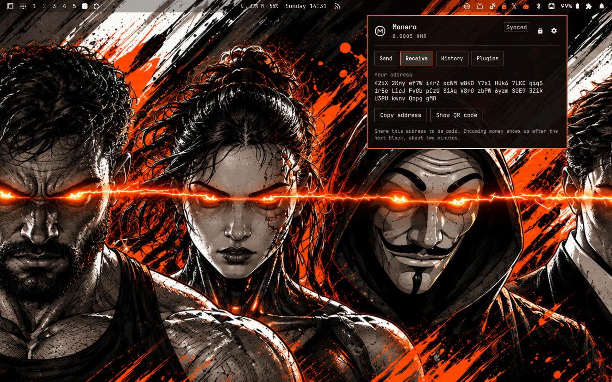

# omanero

Omarchy plugin: a small hot Monero wallet in the bar. Create a wallet or
restore one from its seed, send and receive, and tip the Monero addresses you
come across on X: the bar icon shows when the page in front has one.

There is no local node and no blockchain on your computer. The wallet talks to
a public node you pick; your keys stay in an encrypted wallet file on this
machine.

**This is a hot wallet for small amounts.** It has not been audited. Keep in it
what you would keep in a pocket, and keep the 25-word seed on paper.

## Requirements

- Omarchy **Quattro** (v4.5+) with the plugin runtime
- `monero-wallet-rpc` on your `PATH`: `sudo pacman -S monero`, or without
  root, the one file from the signed release at
  [getmonero.org/downloads](https://www.getmonero.org/downloads/) placed in
  `~/.local/bin`
- `python3`
- `wl-clipboard` for the Copy address button (ships with Omarchy)
- `qrencode` for the QR code on the Receive tab (ships with Omarchy)

## Install

```sh
git clone https://github.com/sette7blo/omanero
cd omanero
./install.sh
```

`install.sh` links the plugin, the `omanero` command and a launcher, and makes
omanero the handler for `monero:` links unless another wallet already is
(`--take-links` overrides that). It never creates or touches a wallet.

`./uninstall.sh` reverses it and **leaves your wallet files alone**.

## Using it

Click the Monero icon on the bar.

| Step | What happens |
|---|---|
| New wallet | Pick a password. The 25-word seed and the restore height are shown once: write both down. |
| Restore from seed | Enter the 25 words, a restore height (a block number, or a date like `2024-03-15`) and a new password. The wallet then scans from that height, which can take a while for an old wallet. |
| Unlock | Type the password. The wallet locks itself again after 30 idle minutes (changeable, 0 turns it off). |
| Send | Enter an address and an amount, press Review, read the address, amount, fee and total, then Send. Nothing leaves the wallet before that last press. |
| Receive | Shows your address with a Copy button. |
| History | Recent payments in and out. |





Middle-click the bar icon to lock. Right-click opens this file.

A new or restored wallet has to catch up with the network before it can send.
Even a brand-new wallet walks the list of past blocks once, which takes from a
few minutes to a quarter of an hour depending on the node. The panel shows how
many blocks are left, and the wallet answers slowly while it does this. Later
unlocks only catch up on what happened since the last one.

### More than one wallet

Settings has a **Wallet** section:

- **Add a wallet** creates or restores another one under a name you choose.
  It has its own seed and password, and becomes the wallet in use.
- With more than one, press a wallet's name to switch. The current one is
  locked first.
- **Remove this wallet** takes it out of omanero. Its files are moved to
  `~/.local/share/omanero/<network>/removed/`, never deleted, but to reach the
  money again you need its 25-word seed, so write that down first.

One wallet is open at a time. Mainnet and stagenet each have their own set.

### Restore height

Monero cannot look up "your" transactions; the wallet has to scan blocks for
them. The restore height says where to start. Too early only costs time. Too
late hides money that arrived before it. A new wallet's height is shown next
to its seed; `omanero status` shows it again.

16-word Polyseed phrases (Cake Wallet's default for new wallets) cannot be
restored yet. Cake can show the legacy 25-word seed for such a wallet; use
that one.

### Nodes

Settings has a node field and three suggestions, the same defaults Cake Wallet
ships:

- `xmr-node.cakewallet.com:18081`
- `node.sethforprivacy.com:443`
- `nodes.hashvault.pro:18081`

Any public node works. A node sees your IP address and the payments you send
through it. It never sees your keys or your balance. Changing the node locks
the wallet.

Stagenet (play money) is a switch in Settings and has its own wallet.

## Tipping on X

omanero ships a small browser extension, in `extension/`, for Brave, Chromium,
Chrome, Vivaldi and Edge. It only reads x.com pages: it makes no network
requests and holds no keys. The one thing it stores is the list of handles it
has seen with an address.

`install.sh` sets it up: on Omarchy it adds the extension to the browser's
flags file (`~/.config/brave-flags.conf`, `chromium-flags.conf`), the same way
Omarchy loads its own, and writes the link that lets it reach the wallet tool.
Restart the browser once. Chrome and Edge ignore that flag; there, open the
extensions page, turn on **Developer mode**, press **Load unpacked** and choose
the `extension` folder of this project.

It works in your main browser profile, including Omarchy's web apps. A browser
started on a profile of its own, such as a web app popover with a separate
profile, is left alone: no Tip controls, no lit icon.

After that:

- When the X tab in front shows a Monero address in a profile bio or a post,
  the Monero icon on the bar lights up in the accent colour. Open the panel and press
  **Tip @name**.
- Or press the **Tip XMR** control the extension puts under the bio or post.
  The panel opens with the address filled in.
- People whose bio you have seen with an address get a small **XMR** badge next
  to their name in the feed and in followers and following lists. Press it to
  tip. The extension learns this as you browse: from a profile you open, a
  hover card, or a list row that shows the bio. It is kept in the browser only,
  for the last 2,000 people, and dropped when their bio no longer has an
  address. Someone whose bio you have never had on screen gets no badge.
- Either way you enter the amount, press Review, check it, press Send.


**Nothing verifies these addresses.** Anyone can write any address in a post
or a reply, and scammers do. The panel says where the address was seen; make
sure it is the person you mean before the last press. omanero never sends on
its own.

The same panel answers any `monero:` link, from any site or app.

## Tipping plugin authors

The **Plugins** tab lists the Omarchy plugins installed on this machine whose
author has published a Monero address, each with a **Tip** button. It reads
the manifests already on disk; nothing is fetched.

The address is whatever the installed copy says. A fork or a tampered copy
can carry someone else's address, so the list shows where each plugin came
from, and the send form says the address is not verified.


### For plugin authors

Add one field to your plugin's `manifest.json`:

```json
"funding": { "monero": "4..." }
```

- A standard address or a subaddress, mainnet. A subaddress per plugin lets
  you tell the tips apart.
- Omarchy ignores fields it does not know, so the plugin still validates and
  loads as before.
- Anything else that reads manifests, a plugin manager for instance, can offer
  the same button by opening `monero:<address>?recipient_name=<plugin name>`.
  Any Monero wallet that handles `monero:` links will answer it.

## Command line

```sh
omanero status                 # balance, address, sync state
omanero create                 # new wallet, prints the seed once
omanero restore                # asks for seed, restore height, password
omanero unlock | lock
omanero wallets                # list them; * marks the one in use
omanero create --name tips     # add another wallet (restore takes --name too)
omanero use tips               # switch
omanero forget tips            # take it out; the files are moved aside
omanero send <address> <amount>   # shows the fee and asks before sending
omanero history
omanero qr                     # the wallet address as a QR code
omanero plugins                # installed plugins whose author can be tipped
omanero seed                   # show the seed of the unlocked wallet
omanero config                 # show settings
omanero config set node node.sethforprivacy.com:443
omanero open 'monero:...'      # what the link handler runs
```

## Where things live

| Path | What |
|---|---|
| `~/.local/share/omanero/<network>/` | The wallet files. The seed on paper is the backup; never delete these with money in them. |
| `~/.config/omanero/config.json` | Node, network, auto-lock |
| `~/.local/state/omarchy/omanero/` | Session files while unlocked, mode 600, removed on lock |
| `~/.config/<browser>/NativeMessagingHosts/io.github.sette7blo.omanero.json` | Lets the extension start the wallet tool |

## How it is built

```
bin/omanero        The wallet tool. All money logic is here (Python, no dependencies).
Service.qml        Polls status and runs one command at a time for the panel
Panel.qml          The panel
BarWidget.qml      The bar icon
Model.js           Checks and formats what the tool prints before it is shown
extension/         The browser extension for X (plain JavaScript, no build step)
tests/             test_cli.py (against a fake wallet service), model.test.js, detect.test.js
```

While unlocked, `monero-wallet-rpc` runs on `127.0.0.1` behind a random login
that changes every unlock. Passwords and seeds are passed on stdin, never on a
command line. A payment is built and signed first, shown to you with its real
fee, and only then broadcast, so what you confirm is exactly what is sent.

```sh
python3 tests/test_cli.py
node --test tests/model.test.js tests/detect.test.js
tests/e2e/run.sh               # the extension in a headless browser, fake X page
omarchy plugin validate .
```

## Roadmap

See [ROADMAP.md](ROADMAP.md).

## License

MIT
