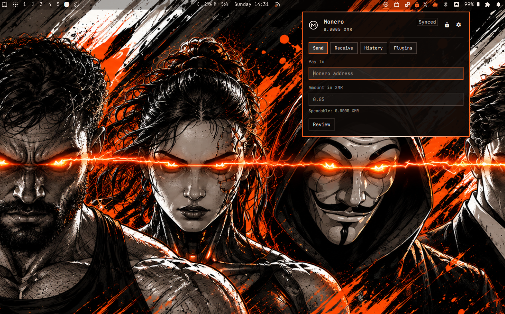
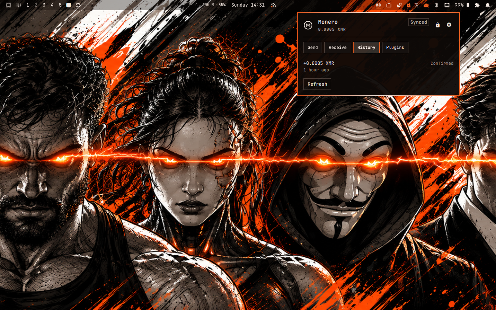
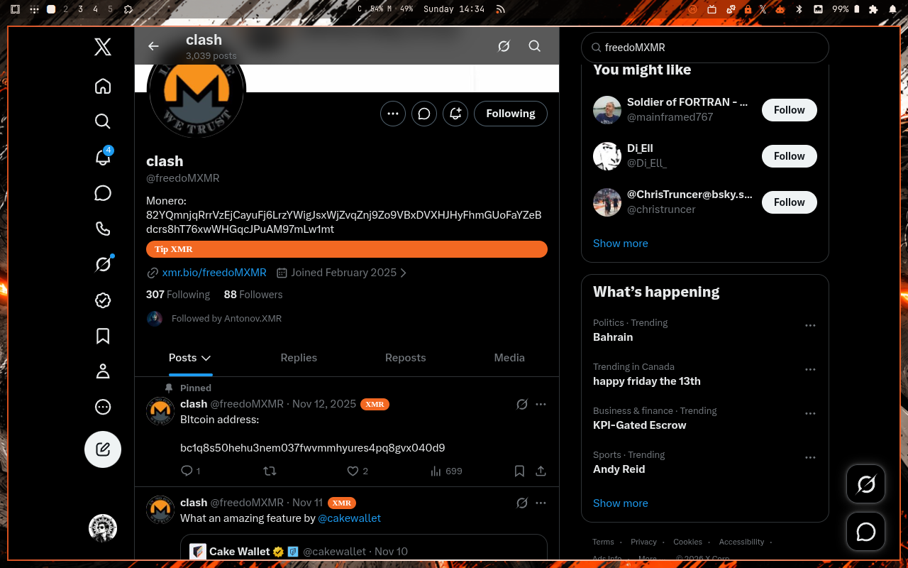
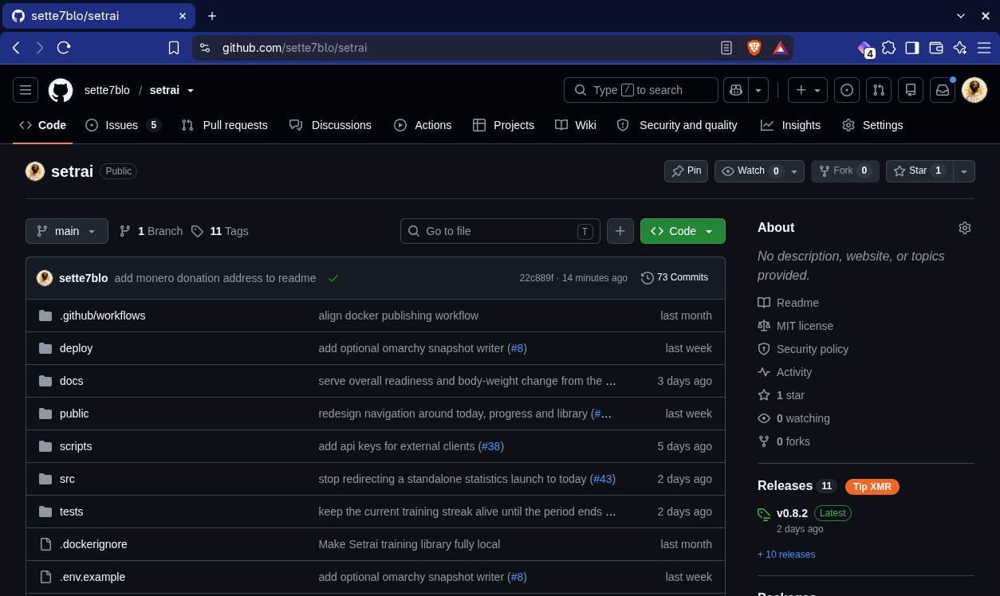
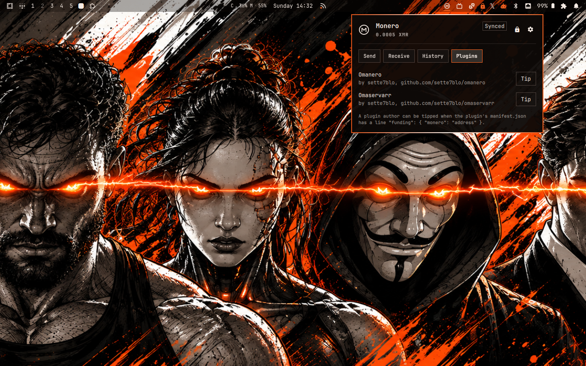

# omanero

Omarchy plugin: a small hot Monero wallet in the bar. Create a wallet or
restore one from its seed, send and receive, tip the Monero addresses you
come across on X and on GitHub, and tip the authors of installed plugins that
publish an address. The bar icon shows when the page in front has one.

There is no local node and no blockchain on your computer. The wallet talks to
a public node you pick; your keys stay in an encrypted wallet file on this
machine.

**This is a hot wallet for small amounts.** It has not been audited. Keep in it
what you would keep in a pocket, and keep the 25-word seed on paper.

## Requirements

Omarchy **Quattro** (v4.5+) with the plugin runtime.

## Install

```sh
omarchy plugin add https://github.com/sette7blo/omanero.git --enable
```

That is the only command. The first time the plugin loads, it installs
`monero-wallet-rpc`, `python3`, `qrencode`, and `wl-clipboard` if any of them
are missing. A terminal opens for your password when a package has to be
installed. It also links the `omanero` command and a launcher, makes omanero
the handler for `monero:` links unless another wallet already is, and adds the
browser extension for X and GitHub to the browser flags Omarchy already uses. Restart the browser
once and the Tip controls appear.

It never creates or touches a wallet.

To remove it, run the uninstaller in the plugin folder, then remove the plugin.
The uninstaller leaves your wallet files and the `monero` package alone.

```sh
~/.config/omarchy/plugins/io.github.sette7blo.omanero/uninstall.sh
omarchy plugin remove io.github.sette7blo.omanero
```

## Using it

Click the Monero icon on the bar.

| Step | What happens |
|---|---|
| New wallet | Pick a password. The 25-word seed and the restore height are shown once: write both down. Locking the wallet takes them off the screen; `omanero seed` shows the seed again after unlocking. |
| Restore from seed | Enter the 25 words, a restore height (a block number, or a date like `2024-03-15`) and a new password. The wallet then scans from that height, which can take a while for an old wallet. |
| Unlock | Type the password. The wallet locks itself again after 30 idle minutes (changeable, 0 turns it off). |
| Send | Enter an address and an amount, press Review, read the address, amount, fee and total, then Send. Nothing leaves the wallet before that last press. |
| Receive | Shows your address with a Copy button. |
| History | Recent payments in and out. |






Middle-click the bar icon to lock. Right-click opens this file.

The header names what is open. With more than one wallet, its title is the
wallet's name instead of "Monero"; the bar icon's tooltip says it too. On
stagenet the balance reads `2.5 XMR · Stagenet`, so play money never looks
like the real thing.

Keys, while no text field has the cursor:

| Key | Does |
|---|---|
| `1` `2` `3` `4` | Send, Receive, History, Authors |
| `Tab`, `Shift+Tab`, `h` `l`, Left Right | Previous or next tab |
| `W` | Show or hide the list of wallets, with more than one |
| `Shift+L` | Lock |
| `Esc` | Close the wallet list, or the panel |

A new or restored wallet has to catch up with the network before it can send.
Even a brand-new wallet walks the list of past blocks once, which takes from a
few minutes to a quarter of an hour depending on the node. The panel shows how
many blocks are left, and the wallet answers slowly while it does this. Later
unlocks only catch up on what happened since the last one.

### More than one wallet

Settings has a **Wallet** section:

- **Add a wallet** creates or restores another one under a name you choose.
  It has its own seed and password, and becomes the wallet in use.
- With more than one, press a wallet's name to switch. The current one is
  locked first. The wallet button in the header, or `W`, shows the same list
  without going into Settings.
- **Remove this wallet** takes it out of omanero. Its files are moved to
  `~/.local/share/omanero/<network>/removed/`, never deleted, but to reach the
  money again you need its 25-word seed, so write that down first.

One wallet is open at a time. Mainnet and stagenet each have their own set.

### Restore height

Monero cannot look up "your" transactions; the wallet has to scan blocks for
them. The restore height says where to start. Too early only costs time. Too
late hides money that arrived before it. A new wallet's height is shown next
to its seed; `omanero status` shows it again.

16-word Polyseed phrases (Cake Wallet's default for new wallets) cannot be
restored yet. Cake can show the legacy 25-word seed for such a wallet; use
that one.

### Nodes

Settings has a node field and three suggestions, the same defaults Cake Wallet
ships:

- `xmr-node.cakewallet.com:18081`
- `node.sethforprivacy.com:443`
- `nodes.hashvault.pro:18081`

Any public node works. A node sees your IP address and the payments you send
through it. It never sees your keys or your balance. Changing the node locks
the wallet.

Stagenet (play money) is a switch in Settings and has its own wallet.

## Tipping on X and GitHub

omanero ships a small browser extension, in `extension/x/`, for Brave, Chromium,
Chrome, Vivaldi and Edge. It reads x.com and github.com pages and holds no
keys. On X it makes no network requests. On GitHub it makes two, described
below. It stores the X handles it has seen with an address, and for a day,
what each GitHub repo it looked up publishes.

The installer adds the extension to the browser flags files Omarchy already
uses, including Chromium, Brave, Chrome, and Edge, and writes the link that
lets it reach the wallet tool. Restart the browser once after installing.

It works in your main browser profile, including Omarchy's web apps. A browser
started on a profile of its own, such as a web app popover with a separate
profile, is left alone: no Tip controls, no lit icon.

After that:

- When the X tab in front shows a Monero address in a profile bio or a post,
  the Monero icon on the bar lights up in the accent colour. Open the panel and press
  **Tip @name**.
- Or press the **Tip XMR** control the extension puts under the bio or post.
  The panel opens with the address filled in.
- People whose bio you have seen with an address get a small **XMR** badge next
  to their name in the feed and in followers and following lists. Press it to
  tip. The extension learns this as you browse: from a profile you open, a
  hover card, or a list row that shows the bio. It is kept in the browser only,
  for the last 2,000 people, and dropped when their bio no longer has an
  address. Someone whose bio you have never had on screen gets no badge.
- Either way you enter the amount, press Review, check it, press Send.



**Nothing verifies these addresses.** Anyone can write any address in a post
or a reply, and scammers do. The panel says where the address was seen; make
sure it is the person you mean before the last press. omanero never sends on
its own.

### On GitHub

On a repository's front page and on a profile, the extension looks in these
places, best first:

| Where | Read how |
|---|---|
| The repo's `manifest.json`, `"funding": { "monero": "4..." }` | Fetched from the repo on screen |
| The repo's `.github/FUNDING.yml`, a `monero:` link under `custom` | Fetched from the repo on screen |
| A profile's bio | Read from the page |
| The README, or a profile README | Read from the page |

The manifest field is the one the Authors tab reads from installed plugins, so
a plugin author who added it there is covered on GitHub too. `FUNDING.yml` is
GitHub's own funding file; it has no Monero entry, and whether GitHub's
Sponsor button accepts a `monero:` link under `custom` is not documented, so
the extension reads one if it is there but does not ask authors to add it.

The two files are fetched from `raw.githubusercontent.com` for the repo
already on screen, without cookies or a referrer, at most once a day per repo.
GitHub learns nothing it did not already see. No other site is ever asked.

A **Tip XMR** control appears beside the Releases heading, or under About when
the repo has no releases. It carries the address from a file, or the first one
in the README when no file names one. A README address that differs from the
file's gets its own control under its paragraph, and so does one in a bio. The
bar icon lights up and the panel offers **Tip owner/repo**. The send form says
where the address came from, and says so when the repo is a fork, since a fork
can carry its own address.



To make your own repo tippable, put your address in the README; nothing else
is needed. A plugin that already has `funding.monero` in its `manifest.json`
is covered without touching the README. As on X, nothing verifies the address:
the control only fills in the send form, and you review before anything is sent.

The same panel answers any `monero:` link, from any site or app.

## Tipping plugin and app authors

The **Authors** tab lists the Omarchy plugins and the apps installed on this
machine whose author has published a Monero address, each with a **Tip**
button. It reads files already on disk; nothing is fetched.

- Plugins publish the address in their `manifest.json`.
- Apps publish it in their AppStream file, the standard metadata file Linux
  apps ship for software centres.

The address is whatever the installed copy says. A fork, a tampered copy or a
modified package can carry someone else's address, so the list shows where
each one came from, and the send form says the address is not verified.



### For plugin authors

The Authors tab reads each installed plugin's `manifest.json`. This is enough
to show a row with **Tip**:

```json
{
  "id": "io.github.you.plugin",
  "name": "Your plugin",
  "author": "yourname",
  "homepage": "https://github.com/you/plugin",
  "funding": { "monero": "4..." }
}
```

`funding.monero` is your address. The other fields are what the row shows.

- The address is 95 characters, a standard address or a subaddress. On mainnet
  it starts with 4 or 8. On stagenet it starts with 5 or 7. An integrated
  address, 106 characters, is accepted too. A subaddress per plugin keeps the
  tips separate.
- The row appears only when omanero's wallet is on that same network. A
  mainnet address stays hidden while the wallet is on stagenet.
- `id` is the plugin id: it starts with a letter or digit, then letters,
  digits, dots, underscores or hyphens.
- `name` is the label on the row. With no name, the row uses the id.
- `author` is shown as "by yourname".
- `homepage` is shown as where the plugin came from. It has to be an `https://`
  URL. Any other value is left out, and the row shows the id instead.
- The file that counts is the installed one,
  `~/.config/omarchy/plugins/<folder>/manifest.json`. After you publish the
  field, update the installed plugin. A folder whose name starts with a dot
  is skipped.

Omarchy ignores fields it does not know, so a plugin with `funding` still
validates and loads. The address is not checked against the author. The row
shows the homepage so the sender can see where that copy came from.

### For app authors: AppStream

Apps that are not Omarchy plugins, a file manager or a photo editor for
instance, can publish their address in their AppStream file. AppStream is the
metadata standard GNOME Software, KDE Discover and Flathub read. Most packages
install it as `/usr/share/metainfo/<app id>.metainfo.xml`.

AppStream has a `<custom>` block for values the standard does not cover, which
any tool reading AppStream may use. Add one value to it:

```xml
<?xml version="1.0" encoding="UTF-8"?>
<component type="desktop-application">
  <id>com.example.yourapp</id>
  <name>Your app</name>
  <summary>What it does</summary>
  <description>
    <p>A few sentences on what the app does and who it is for.</p>
  </description>
  <metadata_license>CC0-1.0</metadata_license>
  <project_license>MIT</project_license>
  <developer id="com.example">
    <name>yourname</name>
  </developer>
  <url type="homepage">https://github.com/you/yourapp</url>
  <url type="donation">https://github.com/sponsors/you</url>
  <launchable type="desktop-id">com.example.yourapp.desktop</launchable>
  <content_rating type="oars-1.1"/>
  <custom>
    <value key="Monero::address">4...</value>
  </custom>
</component>
```

- `Monero::address` is the key omanero looks for. The value follows the same
  rules as the plugin field above: one address, on the network the wallet is
  using.
- `<id>`, the untranslated `<name>`, `<developer><name>` (or the older
  `<developer_name>`) and `<url type="homepage">` are what the row shows. The
  homepage has to be an `https://` URL.
- Keep `<url type="donation">` for your usual donate page. The standard says it
  points to a web page, so the address goes in `<custom>` and not there.
- An app that already ships an AppStream file only needs the `<custom>` block.
  Check the file with `appstreamcli validate yourapp.metainfo.xml`; the example
  above passes, and the `<custom>` block adds no warnings.
- The package has to install the file. If you package the app yourself, or a
  distribution packages it for you, make sure the build copies it to
  `/usr/share/metainfo/`. A package built from a release binary may not pick
  it up on its own.
- omanero reads `metainfo/` and `appdata/` under `~/.local/share` and the
  system data folders (`/usr/local/share`, `/usr/share`, or `$XDG_DATA_DIRS`).
  Only files that mention `Monero::address` are opened. Files with inline
  entity definitions are skipped.

App catalogues such as Flathub may leave `<custom>` values out of what they
publish. The file installed on the machine keeps it, and that is the one
omanero reads.

## Command line

```sh
omanero status                 # balance, address, sync state
omanero create                 # new wallet, prints the seed once
omanero restore                # asks for seed, restore height, password
omanero unlock | lock
omanero wallets                # list them; * marks the one in use
omanero create --name tips     # add another wallet (restore takes --name too)
omanero use tips               # switch
omanero forget tips            # take it out; the files are moved aside
omanero send <address> <amount>   # shows the fee and asks before sending
omanero history
omanero qr                     # the wallet address as a QR code
omanero plugins                # installed plugins and apps whose author can be tipped
omanero seed                   # show the seed of the unlocked wallet
omanero config                 # show settings
omanero config set node node.sethforprivacy.com:443
omanero open 'monero:...'      # what the link handler runs
```

## Where things live

| Path | What |
|---|---|
| `~/.local/share/omanero/<network>/` | The wallet files. The seed on paper is the backup; never delete these with money in them. |
| `~/.config/omanero/config.json` | Node, network, auto-lock |
| `~/.local/state/omarchy/omanero/` | Session files while unlocked, mode 600, removed on lock |
| `~/.config/<browser>/NativeMessagingHosts/io.github.sette7blo.omanero.json` | Lets the extension start the wallet tool |

## How it is built

```
bin/omanero        The wallet tool. All money logic is here (Python, no dependencies).
Service.qml        Polls status and runs one command at a time for the panel
Panel.qml          The panel
BarWidget.qml      The bar icon
Model.js           Checks and formats what the tool prints before it is shown
extension/x/       The browser extension for X (plain JavaScript, no build step)
tests/             test_cli.py (against a fake wallet service), model.test.js, detect.test.js
```

While unlocked, `monero-wallet-rpc` runs on `127.0.0.1` behind a random login
that changes every unlock. Before the tool sends it anything, whatever answers
on that port has to prove it holds the login, so another program that got to the
port first is told nothing. Passwords and seeds are passed on stdin, never on a
command line. A payment is built and signed first, shown to you with its real
fee, and only then broadcast, so what you confirm is exactly what is sent.

```sh
python3 tests/test_cli.py
node --test tests/model.test.js tests/detect.test.js
tests/e2e/run.sh               # the extension in a headless browser, fake X page
omarchy plugin validate .
```

## Roadmap

See [ROADMAP.md](ROADMAP.md).

## License

MIT
